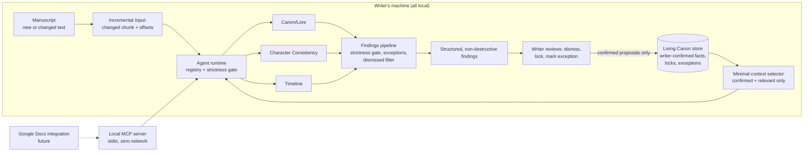

# Lorewardens Architecture

A modular multi-agent system that analyzes fiction as it is written and flags
problems in specialized domains. The writer stays in their existing tools.
Agents never auto-rewrite or take creative control.

## Component map

| Component | Package | Status | Depends on |
| --- | --- | --- | --- |
| Core domain (types, strictness, canon store, context selector, agent contract, registry) | `packages/core` | current | — |
| Continuity agents (Canon/Lore, Character Consistency, Timeline) | `packages/agents` | current (increment 1: deterministic lexical matchers) | core |
| Local MCP server (stdio, no external permissions) | `packages/mcp-server` | current (increment 1: analyze tools + read-only `canon_list`, fixture-seeded canon store, smoke script) | core, agents |
| Seeded-error proof suite | `packages/proof` | current (increment 1: seeded manuscript + automated suite driving `runAnalyzeTool`; catch table, strictness matrix, clean silence, schema/offsets, determinism) | core, agents, mcp-server |
| Living Canon store persistence | `packages/core` (v0 in-memory; file-backed next) | current | core types |
| Google Docs integration (extension + sidebar/comments, OAuth Testing mode) | future package | potential | mcp-server |
| Broader agent roster (Domain, Language & Prose, Narrative, Optional — 14 more) | `packages/agents` | potential | core, agents |

The full agent roster (17 writer-selectable agents across Continuity / Domain /
Language & Prose / Narrative / Optional) is specified in
`project-files/Lorewardens Agents.md`. Increment 1 ships the three Continuity
agents; the registry and contract are roster-agnostic so later agents slot in
without contract changes.

## Flow

## Key decisions

1. **TypeScript monorepo (npm workspaces).** The MCP SDK is TypeScript-native
   and the future browser extension shares the same types. See
   `.project/architect/decisions/0001-typescript-monorepo.md`.
2. **Findings are data, not edits.** The only write paths in the system are
   writer-confirmed canon proposals, exceptions, and dismissals.
3. **Strictness is a runtime gate driven by finding metadata.** Agents stamp
   every finding with `minStrictness` and `confidence`; the runtime decides
   what surfaces. See `docs/agent-contract.md`.
4. **Incremental by contract.** Agents receive only the changed chunk plus the
   minimal canon context selected for it — never the whole manuscript.
5. **MCP-first MVP.** The local stdio MCP server is the first integration;
   Google Docs (OAuth Testing mode, unpacked extension) comes next.

## Detailed docs

- `docs/living-canon-data-model.md` — canon entries, characters, timeline events, locks, exceptions, confirmation flow
- `docs/findings-schema.md` — finding shape and semantics (JSON Schema in `schemas/finding.schema.json`)
- `docs/agent-contract.md` — the interface every agent implements, strictness levels, incremental input rule
